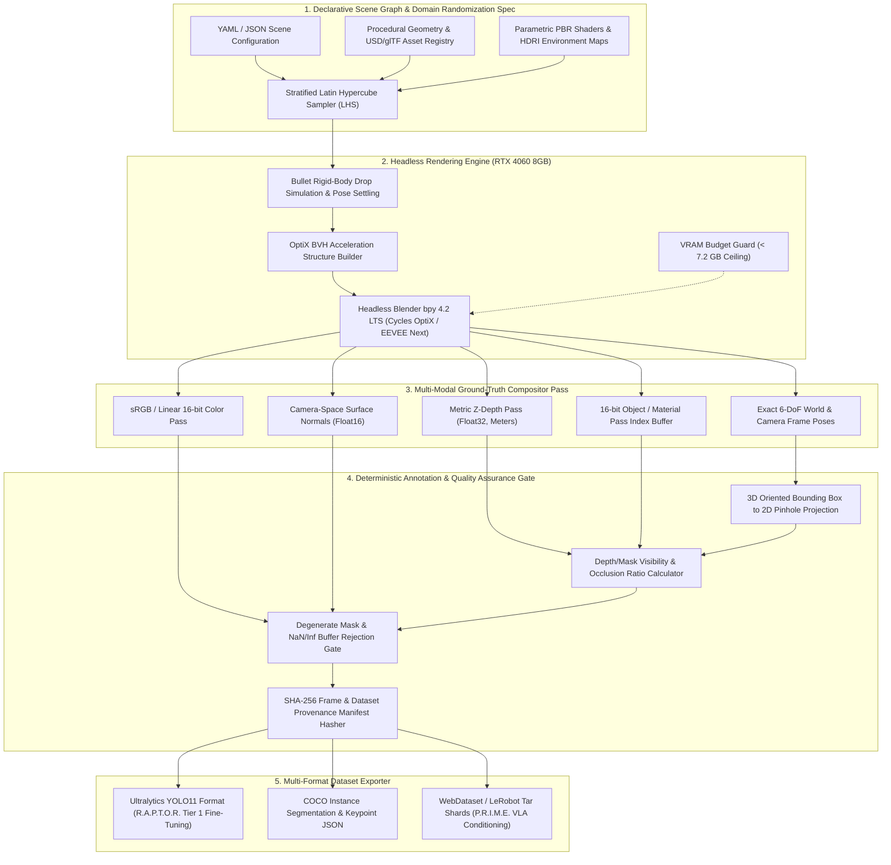

# M.I.R.A.G.E. — Multimodal Intelligent Rendering & Automated Generation Engine

[](https://opensource.org/licenses/Apache-2.0)
[](https://www.python.org/)
[](https://www.blender.org/)
[](https://developer.nvidia.com/optix)

## Technical Abstract

M.I.R.A.G.E. (Multimodal Intelligent Rendering & Automated Generation Engine) is a deterministic, headless synthetic perception data generation pipeline engineered to resolve the real-world robotic training data bottleneck on single-GPU workstation hardware (NVIDIA RTX 4060 8 GB VRAM). Real-world collection and manual annotation of 2D/3D bounding boxes, dense depth maps, surface normals, and pixel-accurate instance segmentation masks are prohibitively expensive and prone to human labeling boundary error, particularly under heavy occlusion, specular lighting transitions, and non-uniform clutter.

M.I.R.A.G.E. procedurally constructs physically based scenes using stratified Latin Hypercube Sampling (LHS) across geometry, Physically Based Rendering (PBR) shader parameters, High Dynamic Range Imaging (HDRI) illumination, camera intrinsics/extrinsics, and rigid-body physics drop simulations. Built atop the headless Blender 4.2 LTS `bpy` C-extension runtime with NVIDIA OptiX hardware raytracing and EEVEE Next rasterization, M.I.R.A.G.E. extracts synchronized multi-modal ground truth in a single compositor pass and exports verified datasets directly into Ultralytics YOLO11 format for [R.A.P.T.O.R.](https://github.com/madhavmadupu/raptor) Tier 1 detector fine-tuning, COCO JSON, and Hugging Face LeRobot / WebDataset shards for [P.R.I.M.E.](https://github.com/madhavmadupu/prime) visuomotor policy conditioning.

---

## System Architecture



### Pipeline Stages

1. **Declarative Scene Graph & Domain Randomization Spec**: Ingests deterministic YAML/JSON scene specifications defining target object meshes, distractor clutter distributions, continuous parameter ranges for metallic/roughness/index-of-refraction PBR shaders, HDRI rotation and exposure intervals, and camera intrinsic matrices. Parameter combinations are sampled via stratified Latin Hypercube Sampling (LHS) keyed by a 64-bit master PRNG seed to guarantee uniform space-filling coverage across high-dimensional configuration spaces without clustering.
2. **Headless Rendering Engine**: Executes inside an isolated worker process running headless Blender `bpy` with CUDA/OptiX device selection. Before rendering, objects are spawned above the support surface and stepped through 120 ticks (2.0 simulated seconds at 60 Hz) of Bullet rigid-body physics to achieve physically stable resting poses without mesh interpenetration. Rendering runs via either EEVEE Next (for high-throughput rasterized training sweeps) or Cycles with NVIDIA OptiX raytracing and OpenImageDenoise/OptiX AI denoising.
3. **Multi-Modal Ground-Truth Compositor Pass**: A programmatic Blender Compositor node graph extracts synchronized multi-layer OpenEXR and PNG buffers in a single render invocation: 8-bit/16-bit RGB, single-channel Float32 metric Z-depth (in meters), 3-channel camera-space unit surface normals, and 16-bit integer `PassIndex` instance and semantic class masks alongside exact 6-DoF transformation matrices $\mathbf{T}_{\text{cam}}^{\text{obj}} \in SE(3)$.
4. **Deterministic Annotation & Quality Assurance Gate**: Computes 2D axis-aligned bounding boxes both from projected 8-corner 3D oriented bounding boxes and from tight morphological bounds of the 16-bit instance mask buffer. Computes exact visibility ratios $V_i \in [0, 1]$ by comparing rendered instance pixel counts against unoccluded single-object raster projections. Rejects frames containing `NaN`/`Inf` depth values, degenerate bounding boxes ($w < 2\text{ px}$ or $h < 2\text{ px}$), or occlusion above user-configured thresholds, and records cryptographic SHA-256 hashes of every artifact in `manifest.json`.
5. **Multi-Format Dataset Exporter**: Serializes validated frames into Ultralytics YOLO11 directory layouts (with automatically generated `data.yaml` files ready for [R.A.P.T.O.R.](https://github.com/madhavmadupu/raptor) training), standard COCO JSON annotations, and POSIX tar shards compatible with WebDataset and Hugging Face LeRobot for [P.R.I.M.E.](https://github.com/madhavmadupu/prime).

---

## Performance & Resource Budget (NVIDIA RTX 4060 8GB)

The following table specifies the **Design Budget / Target Envelope (RTX 4060 8GB)** across supported render profiles. In accordance with engineering reproducibility standards, no unverified empirical claims are hardcoded; actual p50/p95/p99 frame render latency, peak VRAM allocation, and disk write throughput on your host hardware are measured and populated by running:

```bash
python scripts/benchmark.py --profiles eevee_640,cycles_optix_640,cycles_optix_720p --num-frames 100 --output reports/benchmark_results.json
```

*(Alias supported: `python scripts/benchmark_renderer.py`)*

| Render Profile | Resolution | Backend & Samples | Modalities Extracted | Design Budget Latency (p50) | Design Budget Latency (p95) | Peak VRAM Budget | Target Throughput |
| :--- | :--- | :--- | :--- | :--- | :--- | :--- | :--- |
| `eevee_fast_640` | 640 x 640 | EEVEE Next (16 spp, GTAO) | RGB, Depth, Normals, InstMask, 6-DoF | <= 85 ms / frame | <= 120 ms / frame | <= 3.8 GB | >= 10.0 FPS |
| `cycles_optix_640` | 640 x 640 | Cycles OptiX (32 spp + OptiX Denoise) | RGB, Depth, Normals, InstMask, 6-DoF | <= 240 ms / frame | <= 310 ms / frame | <= 5.4 GB | >= 4.0 FPS |
| `cycles_optix_720p` | 1280 x 720 | Cycles OptiX (64 spp + OptiX Denoise) | RGB, Depth, Normals, InstMask, 6-DoF | <= 580 ms / frame | <= 750 ms / frame | <= 6.8 GB | >= 1.6 FPS |
| `qa_projection_gate` | 1280 x 720 | CPU/NumPy Vectorized QA Gate | 3D-to-2D Box Projection + Occlusion Filter | <= 12 ms / frame | <= 19 ms / frame | <= 0.4 GB (Host RAM) | >= 80.0 FPS |

---

## Repository Structure

```text
mirage/
├── README.md                          # Architecture overview, budgets, and usage guide
├── MASTER_SPEC.md                     # Mathematical formulations: camera projection, LHS, occlusion
├── LICENSE                            # Apache-2.0 License
├── SECURITY.md                        # Asset sanitization, EXR buffer bounds, and security policy
├── CONTRIBUTING.md                    # Engineering standards, deterministic PRNG rules, test gates
├── CITATION.cff                       # Bibliographic citation metadata
├── codemeta.json                      # CodeMeta software metadata descriptor
├── llms.txt                           # Concise index for LLM context ingestion
├── llms-full.txt                      # Consolidated technical specification for LLM agents
├── AGENTS.md                          # Instructions for autonomous coding agents
├── CLAUDE.md                          # Claude Code workflow commands and architectural invariants
├── .gitignore                         # Exclusions for rendered datasets, .blend caches, and binaries
├── .gitattributes                     # Line ending normalization and LFS rules
├── configs/
│   ├── tabletop_manipulation.yaml     # Default scene spec for P.R.I.M.E. tabletop grasping objects
│   └── industrial_anomaly.yaml        # Defect and obstacle spec for R.A.P.T.O.R. Tier 1 training
├── docs/
│   ├── ARCHITECTURE.md                # Headless bpy worker pool, OptiX VRAM lifecycle, compositor
│   ├── DATA_CONTRACTS.md              # Pydantic v2 schemas for specs, poses, masks, and exports
│   ├── BENCHMARK_METHODOLOGY.md       # Throughput, 0-pixel projection verification, R.A.P.T.O.R. mAP delta
│   └── ADR/
│       ├── 0001-blender-bpy-optix-on-8gb-vram.md
│       ├── 0002-latin-hypercube-domain-randomization.md
│       └── 0003-raptor-yolo-export-pipeline.md
├── src/
│   └── mirage/
│       ├── __init__.py
│       ├── contracts.py               # Pydantic v2 data contracts and serialization schemas
│       ├── sampler.py                 # Stratified Latin Hypercube Sampler & PRNG state manager
│       ├── projection.py              # SE(3) transforms, pinhole projection, occlusion math
│       ├── compositor.py              # Blender bpy compositor node graph & OptiX configurator
│       ├── qa_gate.py                 # Annotation validation, NaN rejection, SHA-256 manifest builder
│       └── exporters/
│           ├── __init__.py
│           ├── yolo.py                # Ultralytics YOLO11 dataset & data.yaml exporter
│           ├── coco.py                # COCO JSON instance segmentation & bbox exporter
│           └── webdataset.py          # Tar shard exporter for LeRobot / P.R.I.M.E.
├── scripts/
│   ├── generate_dataset.py            # CLI entrypoint for synthetic dataset generation
│   ├── benchmark.py                   # Rendering throughput and VRAM telemetry benchmark runner
│   └── benchmark_renderer.py          # Direct CLI wrapper for renderer profiling
└── tests/
    ├── test_projection.py             # Zero-pixel drift 3D-to-2D projection unit tests
    ├── test_sampler.py                # LHS stratification uniformity and determinism tests
    └── test_exporters.py              # Schema validation for YOLO11 and COCO exporters
```

---

## Quickstart & CLI Reference

### Prerequisites

- **OS**: Linux (Ubuntu 22.04/24.04) or Windows 11 with NVIDIA Driver >= 550.54
- **Python**: Python 3.11 (required for `bpy >= 4.2.0` wheel compatibility)
- **GPU**: NVIDIA RTX GPU supporting Compute Capability >= 8.6 (tested target: NVIDIA RTX 4060 8 GB VRAM)

### Installation

```bash
git clone https://github.com/madhavmadupu/mirage.git
cd mirage
python -m venv .venv
# On Windows PowerShell:
.\.venv\Scripts\Activate.ps1
# On Linux:
# source .venv/bin/activate

pip install --upgrade pip
pip install bpy>=4.2.0 numpy>=1.26.0 scipy>=1.12.0 pydantic>=2.7.0 pyyaml>=6.0.1 pillow>=10.3.0 OpenEXR>=3.2.0 pytest>=8.2.0
```

### Generate a Synthetic Dataset for R.A.P.T.O.R.

```bash
python scripts/generate_dataset.py \
  --config configs/industrial_anomaly.yaml \
  --num-scenes 250 \
  --views-per-scene 4 \
  --backend cycles_optix \
  --resolution 640 640 \
  --seed 42 \
  --export-formats yolo11 coco \
  --output-dir ./datasets/raptor_synth_v1
```

### Verify Dataset Integrity and Zero-Pixel Projection Accuracy

```bash
python scripts/generate_dataset.py \
  --verify-manifest ./datasets/raptor_synth_v1/manifest.json \
  --check-projection-drift
```

### Run Hardware Benchmark Suite

```bash
python scripts/benchmark_renderer.py \
  --profiles eevee_fast_640,cycles_optix_640,cycles_optix_720p \
  --num-frames 100 \
  --warmup-frames 10 \
  --output reports/rtx4060_benchmark.json
```

---

## Physical AI Portfolio Ecosystem

M.I.R.A.G.E. serves as the synthetic data engine for the five-repository Physical AI engineering suite by **Madhav Madupu**:

| Repository | System Name | Primary Role in Stack | Integration with M.I.R.A.G.E. |
| :--- | :--- | :--- | :--- |
| **[R.A.P.T.O.R.](https://github.com/madhavmadupu/raptor)** | Real-time Anomaly Perception & Tactical Operational Reconnaissance | Dual-tier edge perception (YOLO11 TensorRT FP16 + VLM fallback) | Consumes M.I.R.A.G.E. YOLO11 exports to fine-tune Tier 1 detectors on rare anomalies and occluded targets |
| **[S.O.N.A.R.](https://github.com/madhavmadupu/sonar)** | Simulated Optimization & Neural Actuation Runtime | Closed-loop MuJoCo physics control & PPO reinforcement learning | Shares inertial/collision mesh conventions and camera extrinsics calibration conventions |
| **[A.E.G.I.S.](https://github.com/madhavmadupu/aegis)** | Autonomous Entity Guardrail & Intelligent Synchronization | Deterministic 1 kHz CBF-QP safety filter & multi-agent coordinator | Uses M.I.R.A.G.E. synthetic obstacle depth maps to stress-test perception-to-CBF boundary latency |
| **[P.R.I.M.E.](https://github.com/madhavmadupu/prime)** | Physical Reasoning & Intelligent Motor Execution | Vision-Language-Action (VLA) policy & action-chunking controller | Consumes M.I.R.A.G.E. WebDataset/LeRobot shards (RGB + Depth + 6-DoF Pose) for visual domain randomization |
| **[M.I.R.A.G.E.](https://github.com/madhavmadupu/mirage)** | Multimodal Intelligent Rendering & Automated Generation Engine | Physically based synthetic dataset generator & QA pipeline | Generates multi-modal ground truth across the perception and manipulation stack |

### Related Open-Source Engineering by the Author

- **TensorFlow Core Contributor**: Authored [PR #108476](https://github.com/tensorflow/tensorflow/pull/108476) improving XLA/JIT compilation diagnostics and static shape validation for `tf.image.extract_patches`, directly informing the strict tensor shape and buffer boundary checks in M.I.R.A.G.E.'s compositor QA pipeline.
- **Google Cloud Platform / Vertex AI**: Contributed production stateful multi-agent orchestration patterns to Google Vertex AI Agent Engine samples.
- **Foundational AI Systems Repositories**:
  - [T.A.L.O.S.](https://github.com/madhavmadupu/talos) — Task-Autonomous Local Orchestration System
  - [P.R.I.S.M.](https://github.com/madhavmadupu/prism-agentic-rag) — Multi-hop Agentic Retrieval-Augmented Generation
  - [A.T.L.A.S.](https://github.com/madhavmadupu/atlas-ai) — Automated Tool-Learning & Agentic System

---

## Author & License

- **Author**: Madhav Madupu — Applied AI Engineer (Autonomous Systems & AI Infrastructure)
- **GitHub**: [madhavmadupu](https://github.com/madhavmadupu)
- **Contact**: madhav.madupu@gmail.com
- **License**: Licensed under the Apache License, Version 2.0. See [LICENSE](LICENSE) for full terms.
