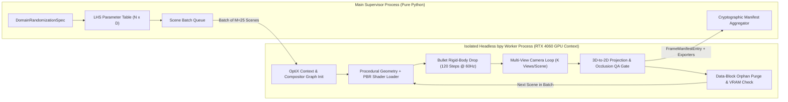
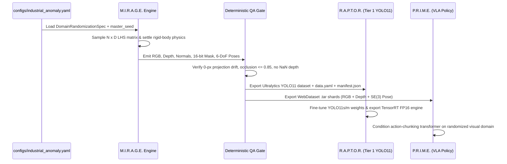

# M.I.R.A.G.E. — System Architecture (`docs/ARCHITECTURE.md`)

## 1. Architectural Design Goals

M.I.R.A.G.E. is designed around four concrete engineering constraints:
1. **Single-GPU Workstation Execution (NVIDIA RTX 4060 8 GB VRAM)**: Must operate reliably within an 8,192 MB GDDR6 memory ceiling without triggering CUDA out-of-memory faults or host-to-device PCIe thrashing during multi-thousand-scene dataset sweeps.
2. **Single-Pass Multi-Modal Ground Truth**: RGB appearance, metric Float32 Z-depth, camera-space unit surface normals, 16-bit instance segmentation masks, and 6-DoF rigid body poses must be extracted from the exact same BVH/raster state in a single render invocation to eliminate inter-pass temporal or floating-point drift.
3. **Zero-Pixel Projection Drift**: Analytical 3D-to-2D bounding box projections must align to within $0.0\text{ px}$ (modulo integer pixel quantization) of the rendered 16-bit instance segmentation mask silhouette.
4. **Direct Downstream Compatibility**: Output artifacts must feed [R.A.P.T.O.R.](https://github.com/madhavmadupu/raptor) (Ultralytics YOLO11 Tier 1 detector fine-tuning) and [P.R.I.M.E.](https://github.com/madhavmadupu/prime) (Hugging Face LeRobot / WebDataset visuomotor policy training) without intermediate conversion scripts.

---

## 2. Headless Blender `bpy` Worker Pool Architecture

Blender's internal C/C++ state (`G.main` database and OpenGL/Vulkan/OptiX contexts) is process-global and not thread-safe across concurrent Python threads. Furthermore, long-running Blender sessions accumulate fragmented GPU buffers if thousands of scenes are constructed in a single process lifetime.

M.I.R.A.G.E. resolves this via a **Supervisor + Recycled Isolated Worker Process Architecture**:



### Worker Lifecycle and Process Recycling
- The supervisor pre-computes the full $N \times D$ Latin Hypercube Sampling parameter matrix upfront so that scene $i \in \{0, \dots, N-1\}$ is completely specified by its index $i$ and deterministic sub-seed $S_i = \text{SHA256\_uint64}(S_0 \parallel i)$.
- A single GPU worker process processes a batch of $M = 25$ scenes (each rendered from $K$ camera views) while keeping the NVIDIA OptiX kernel cache and HDRI environment textures resident in VRAM (`scene.render.use_persistent_data = True` within the $K$ views of a single scene, then reset to `False` on scene teardown).
- After $M = 25$ scenes, or immediately if `torch.cuda.memory_reserved()` / NVML reports VRAM usage exceeding 7.2 GB, the worker process cleanly exits and a fresh subprocess is spawned, guaranteeing zero cumulative memory leaks over 10,000+ frame runs.

---

## 3. OptiX Denoising and VRAM Management on NVIDIA RTX 4060 (8 GB)

The NVIDIA RTX 4060 (AD107 die) provides 24 3rd-generation RT Cores and 96 4th-generation Tensor Cores paired with 8 GB of GDDR6 VRAM across a 128-bit memory bus (272 GB/s bandwidth). To maximize raytracing throughput while remaining strictly below 7.2 GB VRAM:

| Subsystem | RTX 4060 Configuration Parameter | Value | Engineering Rationale |
| :--- | :--- | :--- | :--- |
| **Compute Backend** | `cycles.device` / `compute_device_type` | `OPTIX` | Offloads BVH traversal to hardware RT cores and denoising to Tensor cores |
| **BVH Layout** | `cycles.debug_bvh_type` | `OPTIX` (Dynamic BVH) | Hardware-accelerated ray-triangle intersection |
| **Sample Count** | `cycles.samples` | `32` (640x640) / `64` (720p) | Balanced with OptiX AI Denoiser (Albedo + Normal guide passes) |
| **Denoising Passes** | `cycles.denoiser` / `denoising_input_passes` | `OPTIX` / `RGB_ALBEDO_NORMAL` | Preserves sharp geometric edges at 32 spp without high-sample cost |
| **Light Tree** | `cycles.use_light_tree` | `True` | Reduces variance in multi-light industrial scenes at low sample counts |
| **Max Bounces** | `max_bounces` (Diff/Gloss/Trans) | `4` (`2` / `2` / `4`) | Eliminates fireflies and caps ray recursion stack depth in VRAM |
| **Tile Size** | `cycles.use_auto_tile` / `tile_size` | `True` / `1024` | Avoids tiling overhead at <= 1280x720 while protecting 8 GB VRAM on larger buffers |
| **Texture Limit** | `scene.render.simplify_gpencil` / Texture Cap | `2048 x 2048` max PBR map | Prevents a single 8K HDRI/texture set from consuming > 1.2 GB VRAM |

### Non-Color Pass Filtering Rule
Crucially, **OptiX denoising is applied ONLY to the RGB beauty pass**. The `Depth`, `Normal`, and `IndexOB` (`PassIndex`) sockets bypass the denoiser entirely and are routed with nearest-neighbor / un-antialiased sampling where applicable so that depth discontinuities and integer object IDs are never blurred or interpolated across object boundaries.

---

## 4. Compositor Node Graph Specification

M.I.R.A.G.E. programmatically constructs a deterministic Blender Compositor node tree (`src/mirage/compositor.py`) attached to `scene.node_tree`:

```mermaid
flowchart LR
    RL["CompositorNodeRLayers\n(ViewLayer: 'MirageGT')"]

    subgraph Beauty["Appearance Branch"]
        Denoise["CompositorNodeDenoise\n(HDR=True, Prefilter=ACCURATE)"]
        OutRGB["CompositorNodeOutputFile\nFormat: PNG (8/16-bit sRGB)\nPath: rgb/{frame_id}.png"]
        RL -->|Noisy Image + Denoising Normal + Albedo| Denoise --> OutRGB
    end

    subgraph Geometry["Metric Geometry Branch (Unfiltered)"]
        DepthClamp["CompositorNodeMapRange\nClamp > 100.0m to 0.0m"]
        OutDepth["CompositorNodeOutputFile\nFormat: OPEN_EXR (Float32, ZIP)\nPath: depth/{frame_id}.exr"]
        OutNorm["CompositorNodeOutputFile\nFormat: OPEN_EXR (Float16, ZIP)\nPath: normals/{frame_id}.exr"]
        RL -->|Depth (Z)| DepthClamp --> OutDepth
        RL -->|Normal (World)| OutNorm
    end

    subgraph Semantics["Instance & Class Branch (Exact Integer)"]
        IDScale["CompositorNodeMath (DIVIDE by 65535.0)\nor Direct EXR Float32 PassIndex"]
        OutMask["CompositorNodeOutputFile\nFormat: PNG (16-bit Grayscale)\nPath: masks/{frame_id}.png"]
        RL -->|IndexOB (PassIndex 1..N)| IDScale --> OutMask
    end
```

### Handling Anti-Aliasing at Instance Boundaries
In Cycles, `IndexOB` can exhibit sub-pixel averaging if multi-sample filter widths exceed 1.0 px, or M.I.R.A.G.E. can extract exact per-object masks via either:
1. Cryptomatte (`use_pass_cryptomatte_object = True`, `pass_cryptomatte_depth = 6`, `use_pass_cryptomatte_accurate = True`), which stores exact floating-point ID-coverage pairs per pixel and resolves the highest-coverage object ID without boundary interpolation artifacts; or
2. Direct `IndexOB` with pixel filter width $\le 0.01\text{ px}$ on the segmentation view layer, guaranteeing exact integer `pass_index` recovery upon multiplication by $65535$.

---

## 5. End-to-End Integration into R.A.P.T.O.R. and P.R.I.M.E.



### R.A.P.T.O.R. Tier 1 Detector Training Loop
When M.I.R.A.G.E. completes a run with `--export-formats yolo11`, it writes:
- `images/train/*.png` and `images/val/*.png` (deterministic 85%/15% scene-level split so multiple camera views of the same physical scene never leak across train and validation splits).
- `labels/train/*.txt` and `labels/val/*.txt` containing normalized bounding boxes (`class_id cx cy w h`) derived from `bbox_2d_tight`.
- `data.yaml` pre-configured with relative paths, class names, and the `dataset_merkle_sha256` provenance field so [R.A.P.T.O.R.](https://github.com/madhavmadupu/raptor) can immediately launch `yolo detect train data=datasets/raptor_synth_v1/yolo11/data.yaml model=yolo11s.pt imgsz=640 device=0`.
